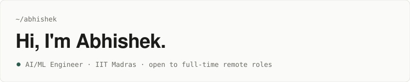
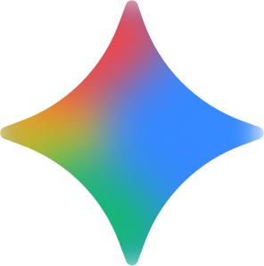
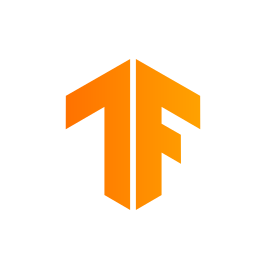
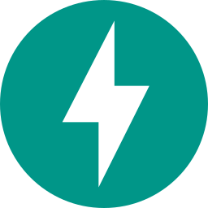
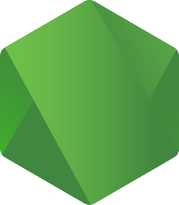
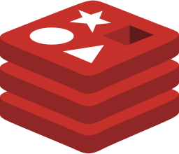
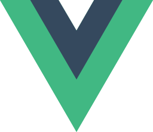
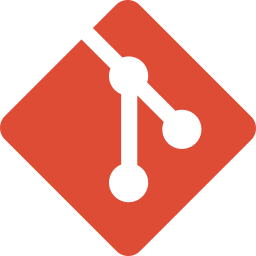

<picture>
  <source media="(prefers-color-scheme: dark)" srcset="assets/header-dark.svg">
  
</picture>

Most AI projects never leave the demo. I build the ones that do: LLM agents, deep learning models, evaluation and deployment, taken from idea to production in weeks.

Final year of the four-year BS in Data Science at IIT Madras (B.Sc. completed 2026). Previously Founding Engineer at Trackleo Technologies. **Available now for full-time, remote AI/ML roles.**

[Portfolio](https://abhijha8287.github.io/portfolio) · [Resume](https://abhijha8287.github.io/portfolio/resume.pdf) · [LinkedIn](https://www.linkedin.com/in/abhishekjha15/) · [Email](mailto:abhijha8287@gmail.com)

| Rank 1 | Top 1% | <3 months | 15 days |
|:--|:--|:--|:--|
| Kaggle, IIT Madras Data Science Lab | Kaggle, IIT Madras MLP project | to launch Trackleo's first AI platform | to build Pips AI |

### Experience

`Feb 2026 – Jul 2026` &nbsp; **Founding Engineer (Web Developer & Data Scientist)** · Trackleo Technologies 
Launched the company's first AI platform with the CEO in under three months; took a five-class retinal disease classifier from experiment to production.

`Dec 2025 – Jan 2026` &nbsp; **Virtual Data Scientist Intern** · AtliQ Technologies 
Reached 97.8% validation accuracy across 8 fruit types with a computer vision classifier (CNN / ResNet50), cutting inspection from hours to minutes.

`Nov 2025` &nbsp; **AI LLM Intern** · Sudha Gopalakrishnan Brain Centre, IIT Madras 
Cut brain MRI analysis time by an estimated 60% with 11 MCP tools that let an LLM run 3D Slicer in plain English.

`Jan 2025 – Sep 2025` &nbsp; **AI Product Engineering Intern** · Web Karo India 
Built WorkSphere AI, a collaborative productivity platform (estimated 35% task-efficiency gain).

### Competitions

**Rank 1** · <a href="https://www.kaggle.com/competitions/apple-disease-classification-26-t-3/leaderboard" target="_blank">Apple Disease Classification</a> (Kaggle, IIT Madras Data Science Lab) 
**Top 1%** · <a href="https://www.kaggle.com/competitions/engage-2-value-from-clicks-to-conversions/leaderboard" target="_blank">Engage 2: Value from Clicks to Conversions</a> (Kaggle, IIT Madras MLP project)

### Selected work

| | |
|:--|:--|
| [**Pips AI**](https://www.pipsai.online) | Trading platform with an AI coach. Built solo in 15 days. `FastAPI · Next.js · Claude API` |
| [**Butterfly Director AI**](https://github.com/abhijha8287/butterfly-director-ai) | 11 LangGraph agents turn one premise into branching short films. `LangGraph · Celery · Docker` |
| [**LLM Evaluation Platform**](https://github.com/abhijha8287/llm-evaluation-platform) | Benchmarks LLMs across providers with DeepEval metrics and an Elo arena. `LiteLLM · DeepEval · Grafana` |
| [**Data Firefighter**](https://github.com/abhijha8287/Data-Fighter) | Agent that traces data incidents and opens fix PRs after human approval. `LangGraph · FastAPI` |
| [**Long-Video Activity Detection**](https://github.com/abhijha8287/long-video-activity-detection) | Detects 10 activity types in long CCTV video. `YOLO11n · ByteTrack · PyTorch` |
| [**MLOps Pipelines**](https://github.com/abhijha8287/23f3004013_MLOPS_WEEKLY_ASSIGNMENT) | DVC, Feast and MLflow pipelines on Kubernetes. 100/100 at IIT Madras. `MLflow · Kubernetes · Vertex AI` |

### Skills

| | |
|:--|:--|
| **Languages** | &nbsp;Python &nbsp;·&nbsp; &nbsp;TypeScript &nbsp;·&nbsp; &nbsp;JavaScript &nbsp;·&nbsp; SQL |
| **AI & LLMs** | <picture><source media="(prefers-color-scheme: dark)" srcset="assets/tech/openai-dark.svg"></picture>&nbsp;OpenAI &nbsp;·&nbsp; &nbsp;Claude &nbsp;·&nbsp; &nbsp;Gemini &nbsp;·&nbsp; &nbsp;LangChain &nbsp;·&nbsp; &nbsp;Hugging Face &nbsp;·&nbsp; &nbsp;LangGraph &nbsp;·&nbsp; RAG &nbsp;·&nbsp; <picture><source media="(prefers-color-scheme: dark)" srcset="assets/tech/si-modelcontextprotocol-dark.svg"></picture>&nbsp;MCP &nbsp;·&nbsp; &nbsp;Claude Code &nbsp;·&nbsp; AI agents &nbsp;·&nbsp; Prompt engineering &nbsp;·&nbsp; LLM evaluation |
| **Machine learning** | <picture><source media="(prefers-color-scheme: dark)" srcset="assets/tech/tensorflow-dark.svg"></picture>&nbsp;TensorFlow &nbsp;·&nbsp; &nbsp;PyTorch &nbsp;·&nbsp; &nbsp;scikit-learn &nbsp;·&nbsp; XGBoost &nbsp;·&nbsp; &nbsp;OpenCV &nbsp;·&nbsp; <picture><source media="(prefers-color-scheme: dark)" srcset="assets/tech/si-yolo-dark.svg"></picture>&nbsp;YOLO |
| **Backend & data** | &nbsp;FastAPI &nbsp;·&nbsp; <picture><source media="(prefers-color-scheme: dark)" srcset="assets/tech/flask-dark.svg"></picture>&nbsp;Flask &nbsp;·&nbsp; &nbsp;Node.js &nbsp;·&nbsp; &nbsp;PostgreSQL &nbsp;·&nbsp; &nbsp;Redis &nbsp;·&nbsp; <picture><source media="(prefers-color-scheme: dark)" srcset="assets/tech/mongodb-dark.svg"></picture>&nbsp;MongoDB &nbsp;·&nbsp; &nbsp;Supabase &nbsp;·&nbsp; <picture><source media="(prefers-color-scheme: dark)" srcset="assets/tech/prisma-dark.svg"></picture>&nbsp;Prisma &nbsp;·&nbsp; &nbsp;Celery |
| **Frontend** | <picture><source media="(prefers-color-scheme: dark)" srcset="assets/tech/react-dark.svg"></picture>&nbsp;React &nbsp;·&nbsp; <picture><source media="(prefers-color-scheme: dark)" srcset="assets/tech/nextjs-dark.svg"></picture>&nbsp;Next.js &nbsp;·&nbsp; &nbsp;Tailwind CSS &nbsp;·&nbsp; &nbsp;Vue |
| **Cloud & MLOps** | &nbsp;Docker &nbsp;·&nbsp; &nbsp;Kubernetes &nbsp;·&nbsp; &nbsp;Google Cloud &nbsp;·&nbsp; <picture><source media="(prefers-color-scheme: dark)" srcset="assets/tech/aws-dark.svg"></picture>&nbsp;AWS &nbsp;·&nbsp; &nbsp;Git &nbsp;·&nbsp; <picture><source media="(prefers-color-scheme: dark)" srcset="assets/tech/github-dark.svg"></picture>&nbsp;GitHub &nbsp;·&nbsp; &nbsp;MLflow &nbsp;·&nbsp; &nbsp;DVC &nbsp;·&nbsp; Feast &nbsp;·&nbsp; Vertex AI &nbsp;·&nbsp; &nbsp;GitHub Actions &nbsp;·&nbsp; &nbsp;Prometheus &nbsp;·&nbsp; &nbsp;Grafana |
| **MLOps practices** | CI/CD for ML &nbsp;·&nbsp; Experiment tracking &nbsp;·&nbsp; Hyperparameter tuning &nbsp;·&nbsp; Feature stores &nbsp;·&nbsp; Model serving &nbsp;·&nbsp; Model monitoring &nbsp;·&nbsp; LLMOps &nbsp;·&nbsp; Explainable AI (SHAP) &nbsp;·&nbsp; Bias &amp; fairness &nbsp;·&nbsp; ML security |

---

`~/abhishek` · New Delhi, India
